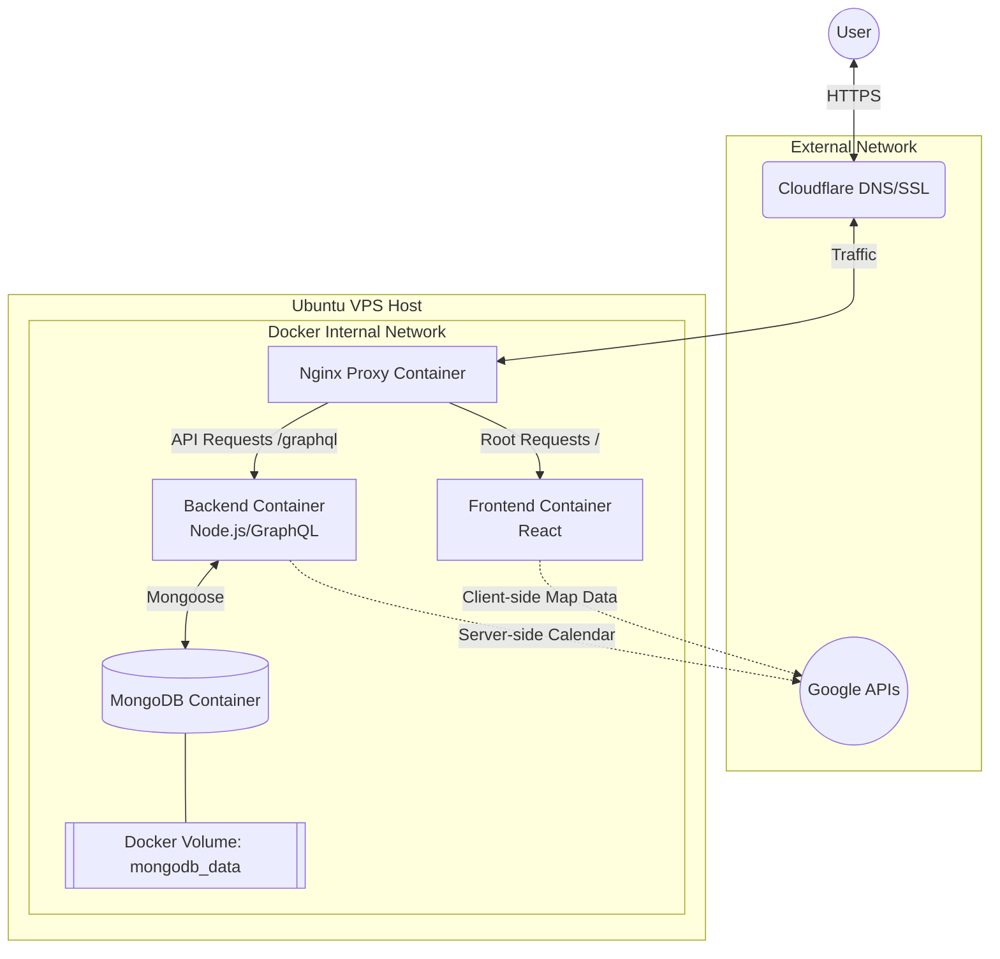
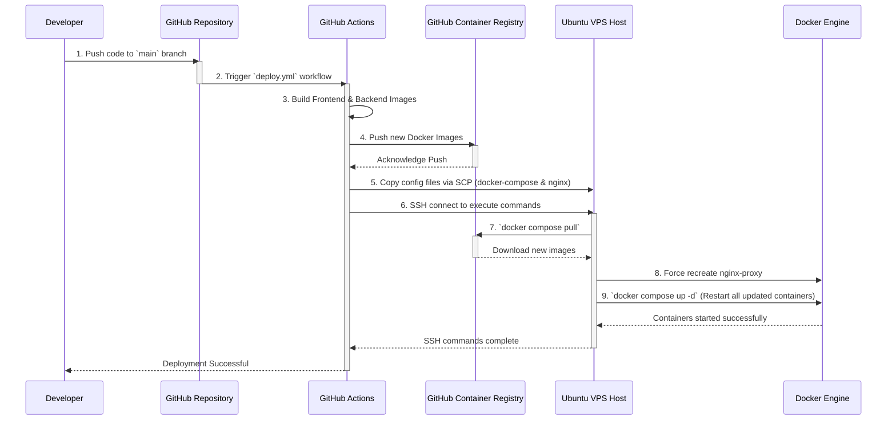

# Journey Planner

A web application to plan your journeys. This app allows you to choose dates for your trips (integrated with Google Calendar to prevent scheduling conflicts with your free time) and interact with a map to pinpoint locations you'd like to visit.

## Tech Stack

**Frontend:**
- React 19
- Vite
- TypeScript
- Tailwind CSS
- Shadcn UI
- Base UI
- Apollo Client
- Google Maps React (`@vis.gl/react-google-maps`)
- Clerk (`@clerk/react`)

**Backend:**
- Express.js
- GraphQL (Apollo Server)
- TypeScript
- MongoDB (via Mongoose)
- Clerk (`@clerk/backend`)

## Architecture



## Project Structure

- `/frontend` - Contains the React application.
- `/backend` - Contains the Express/GraphQL server.

## Setup Instructions

### Prerequisites
- Node.js (v18 or higher recommended)
- MongoDB instance (local or MongoDB Atlas)
- Google Cloud Project with Calendar API and Maps JavaScript API enabled.

### Google Integration

To run this application properly with its full capabilities in production (or to disable local Mock Mode), you need to configure integrations with Google APIs. This provides map interactions and user authentication with Google Calendar.

#### 1. Obtaining a Google Maps API Key
This key is used by the frontend to render the interactive map and handle location coordinates.

1. Go to the <a href="https://console.cloud.google.com/" target="_blank" rel="noopener noreferrer">Google Cloud Console</a>.
2. Create a new project or select an existing one.
3. Navigate to **APIs & Services > Library**.
4. Search for and enable the **Maps JavaScript API**.
5. Go to **APIs & Services > Credentials**.
6. Click **Create Credentials** and select **API key**.
7. Copy the generated key.
8. Set this as `VITE_GOOGLE_MAPS_API_KEY` in your frontend environment variables (`frontend/.env`).

*(Note: It is highly recommended to restrict this API key to your specific domain or IP address in the Google Cloud Console to prevent unauthorized usage).*

#### 2. Setting up Clerk (Sign-in)
Sign-in uses [Clerk](https://clerk.com). Outside Mock Mode you need a Clerk application:

1. Create an application in the [Clerk dashboard](https://dashboard.clerk.com) and enable **Google** (and any other sign-in methods you want) under *User & authentication*.
2. From **API keys**, copy the publishable key and the secret key.
3. Configure the environment variables:
   - Add the publishable key to `frontend/.env` as `VITE_CLERK_PUBLISHABLE_KEY`.
   - Add the secret key to `backend/.env` as `CLERK_SECRET_KEY`.
   - Optionally set `CLERK_AUTHORIZED_PARTIES` in `backend/.env` (comma-separated origins, e.g. `http://localhost:5173`) to only accept session tokens issued for those origins.
4. For production, add your domain to the Clerk instance.

The frontend sends the Clerk session token as `Authorization: Bearer …` and the backend verifies it. On first sign-in, a Clerk user is linked to the existing user with the same email (so accounts from the old Google login keep their plans), or a new user is created.

### Local Development

We use [pnpm Workspaces](https://pnpm.io/workspaces) to manage dependencies.

1. Ensure you are in the root directory.
2. Install dependencies for all workspaces: `pnpm install`
3. Run the development environment:
   ```bash
   pnpm start
   ```

**Mock Mode Details:**
By default, `pnpm start` spins up the application in a sandboxed **Mock Mode**. You do not need any environment variables or external API keys to start working!
- **Database:** An in-memory MongoDB instance is automatically created and seeded with a mock user and events.
- **Authentication:** Clerk is bypassed: the frontend stubs `@clerk/react` via a Vite alias and the backend treats every request as the seeded mock user.
- **Maps:** Google Maps integration is mocked seamlessly via Vite aliases.

### Production Deployment

The production deployment is fully automated using a **GitHub Actions CI/CD** pipeline. We utilize **Cloudflare** for DNS and SSL termination to serve the application on a subdomain.

Here is a high-level summary of the steps involved in the deployment process:
1. **VPS Preparation:** Set up an Ubuntu VPS, install Docker and Docker Compose, and configure SSH keys.
2. **Cloudflare Setup:** Configure domain DNS to point to the VPS using Cloudflare's proxy.
3. **App Configuration:** Prepare the application directories and `.env` variables directly on the VPS.
4. **GitHub Secrets:** Add necessary credentials (VPS IP, username, SSH key, and a GHCR Personal Access Token) as GitHub Secrets.
5. **Automated Pipeline:** On push to the `main` branch, GitHub Actions builds the Docker images, pushes them to the GitHub Container Registry, and restarts the containers via SSH on the VPS.

#### Deployment Flow



For a comprehensive, step-by-step guide on configuring each of these components, please refer to the detailed [**DEPLOYMENT.md**](./DEPLOYMENT.md) documentation.

### GraphQL Code Generation
This project uses GraphQL Code Generator to automatically create TypeScript types and Apollo hooks from `.gql` files.
- To generate types for both backend and frontend, run: `pnpm generate`

## Features

- **Interactive Map:** Click to drop pins on locations you want to visit, or paste Google Maps links to resolve coordinates.
- **Calendar Integration:** Authenticate with Google Calendar to view your free time and automatically create "Journey" events.
- **Data Persistence:** Journeys and pinned locations are saved to a MongoDB database.

## Connect your AI agent (MCP)

Journei exposes an [MCP](https://modelcontextprotocol.io) server, so you can plan trips from your own AI agent (Claude, Cursor, ...) using your own AI subscription. Journei does not call any AI model itself.

- **URL:** `https://<your-journei-domain>/mcp` (locally: `http://localhost:4000/mcp`)
- **Transport:** Streamable HTTP. **Sign-in:** OAuth through Clerk. Your agent opens a browser window, you sign in to Journei and approve access.
- **Claude Code:** `claude mcp add --transport http journei https://<your-journei-domain>/mcp`, then run `/mcp` and choose *Authenticate*.
- **Claude.ai / Claude Desktop:** *Settings → Connectors → Add custom connector*, paste the URL.
- **Cursor and others:** add an HTTP/remote MCP server with the same URL.

Tools: `list_plans`, `get_plan`, `list_destinations`, `list_categories`, `create_destination`, `create_category`, `recommended_places`, `create_plan`, `update_plan`, `create_place`, `update_place`, `create_scheduled_activity`, `update_scheduled_activity`. An agent can only see and change the signed-in user's own plans, and cannot delete anything.

Operator setup: in the Clerk dashboard enable *OAuth applications → Dynamic client registration*, and set `CLERK_PUBLISHABLE_KEY` on the backend (it is used to advertise Clerk as the authorization server). With `pnpm start` (Mock Mode) `/mcp` needs no sign-in.
